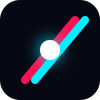

# ⚡ Beat Saber Vision — 3D Web Rhythm Game with Hand Tracking

A high-performance cyberpunk rhythm game inspired by **Beat Saber**, running directly in the browser with real-time **Webcam Hand Tracking** using MediaPipe and Three.js.



---

## 🎮 Herní vlastnosti (Features)

1. **Snímání rukou webkamerou (Hand Tracking)**:
   - Pomocí **MediaPipe Hands** sleduje obě ruce v reálném čase.
   - **Levá ruka** = Červený neonový laserový meč.
   - **Pravá ruka** = Azurový (Cyan) neonový laserový meč.
   - Exponenciální vyhlazování (EMA) eliminuje chvění kamery při zachování okamžité reakce.
   - **Zrcadlení kamery (Mirror mode)**: Přirozený pohyb – když pohnete levou rukou, pohne se levý meč.
   - **Picture-in-Picture (PIP) náhled**: V rohu vidíte obraz z webkamery s vykreslenou neonovou kostrou vašich rukou a stavem sledování.
   - **Okamžitý režim Myš / Dotyk**: Pokud nemáte zapnutou webkameru nebo chcete trénovat na notebooku, hra má plnohodnotný režim ovládání myší či dotykem!

2. **Autentické krájení kostek (Slicing Mechanics)**:
   - 4 dráhy $\times$ 2 výškové úrovně.
   - **Červené kostky** se krájí červeným mečem, **modré kostky** modrým mečem.
   - Směrové šipky (NAHORU, DOLŮ, VLEVO, VPRAVO) a tečky (jakýkoliv směr).
   - **Rozseknutí kostky na dvě poloviny**: Zasažená kostka se fyzikálně rozdělí na dva kusy, které odletí do stran a padají dolů.
   - **Bodování dle Beat Saber pravidel**: Až 115 bodů za kostku (úhel nápřahu, přesnost středu a dokončení švihu) + kombo násobič (až 8x).
   - **Kybernetické bomby s ostny**: Pozor, bombám se musíte vyhnout a nesekat do nich!

3. **3D Neonové Cyberpunk prostředí & Bloom VFX**:
   - Špičková 3D grafika postavená na Three.js s post-processingem **UnrealBloomPass** pro zářící neonové efekty.
   - Nekonečná běžící rampa s neonovými čarami a audio-reaktivními branami.
   - Skleněné equalizer věže podél trati, které skáčou do rytmu basů.

4. **Zvukový syntetizér & Hudební engine (Web Audio API)**:
   - Okamžitý laserový zvuk přeseknutí a dynamický zvuk svištění vzduchu při rychlém máchnutí mečem.
   - 3 přednastavené elektronické / synthwave skladby:
     - **Cyberpunk Neon Pulse** (128 BPM, Normal)
     - **Hyperdrive 2088** (140 BPM, Expert)
     - **Tokyo Midnight Dream** (105 BPM, Easy)
   - **Nahrání vlastní hudby**: Tlačítko *Load Custom Audio* umožňuje nahrát libovolný soubor (.mp3, .wav, .ogg), pro který herní engine automaticky vygeneruje rytmickou mapu kostek!

---

## 🚀 Jak aplikaci spustit

V kořenovém adresáři projektu spusťte:

```bash
# Spuštění vývojového serveru
npm run dev
```

Následně otevřete v prohlížeči (např. Google Chrome, Edge nebo Firefox) adresu:
👉 **`http://localhost:5174/`** (nebo port vypsaný v konzoli).

---

## 🎯 Jak hrát

1. Po otevření stránky povolte přístup k webkameře (vyskakovací okno prohlížeče).
2. Postavte se nebo posaďte tak, aby webkamera dobře viděla vaše ruce.
3. V Picture-in-Picture okně vlevo dole uvidíte zelenou kontrolku a neonové kostry obou rukou.
4. V menu vyberte skladbu a klikněte na **START TRACK**.
5. Sekejte letící kostky ve směru šipek odpovídající barvou meče!
6. Mezerník nebo klávesa `Esc` pauzuje hru.
